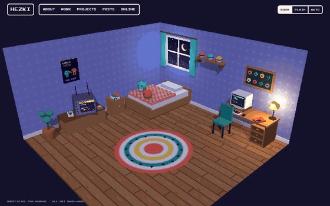

# yehezkieled.github.io

Personal site, served by GitHub Pages from the `main` branch root:
<https://yehezkieled.github.io>

Two versions of the same content:

| Version | URL | What it is |
| --- | --- | --- |
| Room | `/` | A small 3D trainer's bedroom (three.js). Click the PC, badge case, TV, red handheld or phone to open a section. |
| Plain | `/plain/` | Static, text-first page with the same sections. Light/dark theme. |

Viewports narrower than 640 pixels, data-saver connections, devices reporting 2 GB of memory or less, and browsers without hardware WebGL 2 are sent to the plain version automatically. On `/`, `?room=1` forces Room, `?plain=1` forces Plain, and `?auto=1` resets the choice and detects again. Explicit queries take precedence over saved preferences; choices are remembered when browser storage is available.

## Editing content

Profile, section headings, projects, posts and links live in [`content.js`](content.js). After editing it, the shared renderer (`assets/sections.js`) or `plain/template.html`, run `node scripts/render-plain.mjs` with Node.js and commit the source changes and updated `plain/index.html`. The command uses the shared section renderer to keep the delivered no-JavaScript page in sync. Edit `plain/template.html` for Plain page layout and interface text; `plain/index.html` is generated.

## Layout

```
index.html          room page (capability router inline in <head>)
plain/index.html    plain page
content.js          shared portfolio content
assets/sections.js  content -> HTML (shared by both pages)
assets/ui.css       shared tokens + dialog-box components
assets/room.js      the 3D scene (procedural geometry + canvas pixel textures)
assets/room.css     room HUD, panel, loader
assets/plain.*      plain page layout + theme switch
vendor/three/       pinned three.js build (see VERSION)
```

No dependencies to install. See [Editing content](#editing-content) for regeneration requirements. Run any static file server in the repo root to preview, for example `python3 -m http.server 8000`.

All models, textures and icons are hand-made for this site. It is an unofficial fan homage and uses no official game art, sprites, logos, fonts or music.

## Preview



More in [`docs/preview/`](docs/preview/): a 19-second [MP4 tour](docs/preview/room-tour.mp4) and screenshots at desktop, iPad and phone widths.
